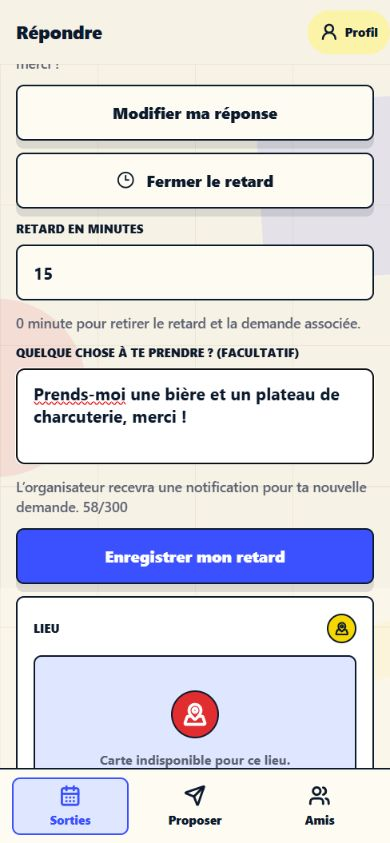
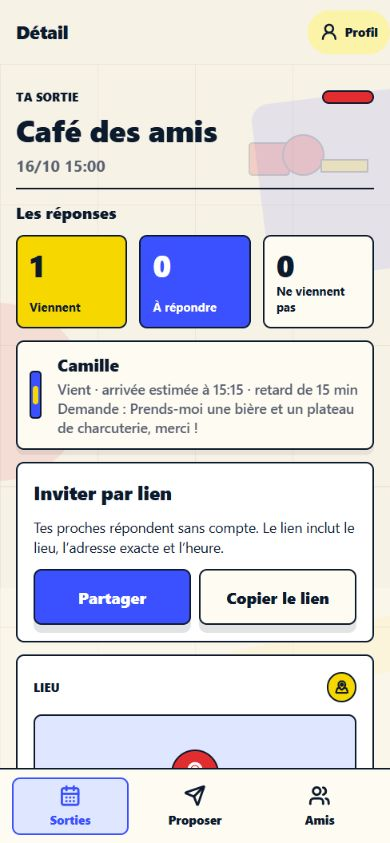

# Demande associée à un retard

Depuis une invitation reçue dans Mates, un participant ayant répondu « Je viens » peut ouvrir « Signaler un retard », saisir ses minutes de retard et ajouter une demande facultative de 300 caractères maximum. Exemple : « Prends-moi une bière et un plateau de charcuterie. » Un seul enregistrement transmet le retard et le message.

Le participant retrouve sa demande dans sa réponse. L’organisateur la voit sous son nom dans le détail de la sortie. Les autres participants et les pages publiques ne reçoivent pas ce message.

## Contrat

`POST /invitations/:id/respond`, avec authentification :

```json
{
  "status": "yes",
  "delayMinutes": 15,
  "advanceRequest": "Prends-moi une bière, merci !"
}
```

- Le message est nettoyé des espaces en début et fin et exige un retard strictement positif.
- Un message vide ou `null` efface la demande. Un refus ou un retard ramené à zéro l’efface aussi.
- Omettre le nouveau champ lors d’une modification d’un retard positif conserve le message, pour les anciennes versions de l’application.
- Les règles existantes d’appartenance à l’invitation, d’annulation et de fermeture après deux heures restent applicables.

## Notification

Une nouvelle demande non vide, ou une modification du texte, déclenche une notification aux appareils de l’organisateur. Le type `invitation.advance_requested` ouvre `/invitations/created/[id]`. Le texte et le retard figurent dans le corps de la notification ; les données de navigation contiennent uniquement son type et l’identifiant de la sortie.

La comparaison du texte précédent et du nouveau texte se fait sous verrou dans la transaction de réponse. Réessayer le même envoi, y compris simultanément, ne déclenche pas une nouvelle notification. Modifier uniquement les minutes ne renvoie pas la même demande. L’effacement du texte n’émet pas de notification.

Les transports Expo et Firebase existants sont réutilisés. Leur livraison reste au mieux : une erreur de transport est journalisée sans annuler la réponse enregistrée. Il n’y a pas de file persistante de renvoi ; la demande reste consultable dans l’application.

## Migration et validation

`apps/api/migrations/0010_advance_requests.sql` ajoute une colonne nullable et une contrainte à `invitation_recipients`. Les réponses historiques restent intactes. Aucune migration de production n’a été lancée dans cette intervention.

Validation : typage API/mobile, compilation partagée et export web réussis. Les 128 tests de 20 fichiers passent, avec PostgreSQL isolé, quatre workers et des délais adaptés aux tests de migrations (`--testTimeout=20000 --hookTimeout=30000`). La génération Drizzle confirme l’absence de divergence entre schéma et migration.

Essais navigateur avec données fictives : saisie du texte, conservation du brouillon après erreur réseau, reprise, récapitulatif invité, affichage organisateur, enregistrement identique sans nouvelle notification simulée et retrait du retard avec effacement de la demande. Affichage à 390 et 320 pixels. Les tests ne transmettent aucune notification réelle ; la réception et l’ouverture depuis une notification sur téléphone restent à vérifier.




