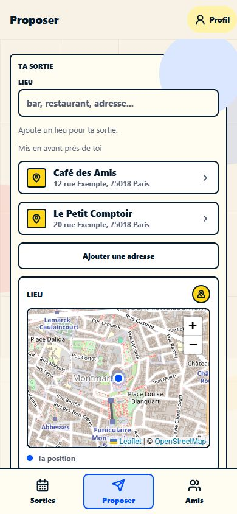

# Statistiques par établissement et catalogue manuel

## Livraison et migration

La migration additive `apps/api/migrations/0011_establishment_statistics.sql` crée le référentiel, les références fournisseur, le rattachement facultatif des invitations, le hash navigateur et deux vues SQL. Les noms/adresses des invitations restent des instantanés historiques. Aucun endpoint de statistiques ou d’administration, tableau de bord, enregistrement des recherches ou des clics n’est ajouté.

Le démarrage API exécute déjà les migrations Drizzle automatiquement : **la prochaine livraison appliquera donc cette migration au démarrage**. La valider sur une restauration de préproduction et obtenir l’autorisation de production avant de déployer. Le backfill parcourt les invitations et crée les index dans la transaction de migration ; son coût dépend de leur volume. Il n’a pas été exécuté en production pendant ce travail.

Les tests utilisent `TEST_DATABASE_URL` sur un serveur PostgreSQL de test, créent leurs propres bases puis les suppriment. Ne jamais fournir une URL de production à ces tests.

## Mesures et limites

| Mesure | Source et période |
| --- | --- |
| Établissements les plus proposés | Invitations par `created_at`, annulations distinguées |
| Participations confirmées | Réponses **actuelles** `yes`, comptes Mates et web, par `scheduled_at` |
| Comptes Mates uniques | Identifiants utilisateur distincts sur ces participations |
| Invités web uniques estimés | Hashes navigateur distincts ; pas des personnes certifiées |
| Total unique estimé | Somme des deux précédents, sans fusion arbitraire |
| Taille moyenne des groupes | Moyenne des oui **par invitation ayant au moins un oui** |

Participations et moyennes : sorties annulées ou futures exclues, bornes `[début, fin)`. L’organisateur n’est pas ajouté implicitement. Une sortie représente un groupe, indépendamment des groupes personnels Mates. Les exemples SQL emploient des bornes `Europe/Paris`, changement d’heure compris.

Il s’agit de confirmations, pas de présences constatées. Un oui devenu non disparaît des totaux ; modifier un retard ou répondre à nouveau ne multiplie pas les participations. Les événements d’audit `accepted` ne sont jamais utilisés. L’historique permet de recalculer l’état actuel des réponses sur les sorties conservées, pas de restituer le nombre de oui à une date passée. Une suppression de compte/sortie selon les règles existantes peut supprimer les données correspondantes : ce référentiel ne constitue pas une archive immuable.

Le navigateur web conserve un UUID aléatoire dans `mates:analytics-browser-id`. Seul son SHA-256 est enregistré, dans `invitation_guest_responses.analytics_browser_id_hash`. Cet identifiant n’autorise aucune lecture/modification de réponse : la clé secrète par invitation est conservée séparément. Le champ public `analyticsBrowserId` est facultatif ; les anciens clients continuent de fonctionner et une mise à jour qui l’omet préserve le hash existant. Une panne du stockage de cette identité facultative ne bloque pas le RSVP.

Les réponses web sans hash participent aux totaux et moyennes, mais n’inventent pas de personne unique : `web_participations_identity_unknown` indique cette couverture manquante. Plusieurs appareils, stockage effacé ou réponses à la fois depuis un compte et le web peuvent représenter une même personne. Les uniques connus peuvent donc surestimer les personnes réelles tout en excluant des invités historiques inconnus. Aucun rapprochement par prénom, IP ou empreinte d’appareil.

## Référentiel et reprise historique

`establishments` : UUID stable, nom, adresse, coordonnées facultatives, pays facultatif, statut de publication, actif, priorité et rayon. `establishment_external_refs` : `(provider, external_id)` unique → établissement. Les références Photon utilisent `N-123` / `W-123` / `R-123` selon le type OSM ; Mapbox utilise l’identifiant de la fiche. Aucun identifiant Photon de secours dépendant de l’index du résultat n’est persisté comme référence externe.

Le rapprochement utilise d’abord une référence fournisseur existante, puis une clé calculée par `public.mates_establishment_key` : nom + adresse normalisés (minuscules, espaces compactés), ou, sans adresse, nom + coordonnées arrondies à cinq décimales. Jamais le nom seul. Les différences d’accents, d’abréviation ou de format d’adresse ne font pas l’objet d’un rapprochement approximatif. Une référence fournisseur permet de retrouver une fiche malgré un format d’adresse différent. Vérifier les références avant une insertion manuelle.

La reprise historique crée seulement des fiches non publiées pour les identités exploitables. Un même nom/adresse avec plusieurs positions historiques distinctes à cinq décimales est laissé sans attribution pour révision manuelle. Une adresse et des coordonnées absentes restent non identifiées. Les requêtes de couverture signalent séparément ces sorties. Aucune source fournisseur n’est inventée pour les anciennes invitations.

Les créations concurrentes sont sérialisées par référence et clé de rapprochement dans la transaction de création, avec unicité en base. En cas d’échec de création, cette opération ne laisse aucun établissement orphelin. Une correction manuelle d’adresse supprime les références et anciennes coordonnées dans le formulaire ; le serveur vérifie aussi la cohérence entre la fiche sélectionnée et l’instantané reçu.

## Publication et affichage

| `listing_status` | Usage |
| --- | --- |
| `unlisted` (défaut) | Statistiques uniquement, jamais retourné par le catalogue public |
| `listed` | Recherche textuelle dès trois caractères, sans GPS ni rayon obligatoire |
| `featured` | Recherche textuelle et bloc de proximité si actif et dans son rayon |

`active = false` retire la fiche des deux surfaces du catalogue sans effacer ses liens statistiques. Les fiches créées automatiquement restent `unlisted`, y compris les adresses privées. La publication est une action SQL explicite après vérification. Éviter les suppressions physiques : elles détachent les invitations (`ON DELETE SET NULL`). Un fournisseur externe peut continuer à retourner sa propre fiche d’un établissement désactivé : la désactivation contrôle le catalogue Mates.

Le bloc **Mis en avant près de toi** apparaît sous Lieu seulement si le champ est vide, aucun lieu sélectionné et une position déjà disponible. Deux lignes existantes au maximum, rayon propre à chaque fiche (`featured_radius_km`, 10 km par défaut), tri priorité décroissante, distance croissante, UUID croissant. Pas de nouvelle demande de localisation. Une saisie masque immédiatement le bloc.

Dès trois caractères, les fiches publiées rejoignent la recherche normale, même sans GPS ou hors rayon. Classement : nom exact, début du nom, puis texte dans le nom/adresse. À pertinence égale, ordre fournisseur conservé, fiches uniquement manuelles ensuite. Déduplication par UUID, référence ou nom/adresse (sinon nom/coordonnées), jamais par nom seul. La liste affiche toujours au plus six résultats. La sélection renseigne l’adresse et réutilise le cadrage existant entre la position de l’utilisateur et le lieu choisi.

Une panne du catalogue masque le bloc et laisse fonctionner le fournisseur. Si le fournisseur est indisponible, les fiches manuelles restent accessibles. Si les deux sont indisponibles, la saisie libre reste possible. Les recherches ne créent aucune fiche. Les endpoints publics en lecture seule sont `GET /places/featured?latitude=…&longitude=…`, `/places/search?q=…` et `/places/catalog?q=…` (pour les configurations de recherche côté client). Ils retournent seulement les champs de sélection du lieu, sans statistiques, priorité, rayon ou identifiants d’invités.

## Utilisation SQL

- `apps/mobile/sql/place_invitation_stats.sql` : classement, participations, uniques, moyenne et couverture des lieux non identifiés. Modifier les deux bornes de chaque CTE `params` ; ajouter `AND e.id = '…'` pour un établissement précis.
- `apps/mobile/sql/establishment_catalog_management.sql` : insertion/promotion, référence fournisseur, priorité, rayon, publication et désactivation. Ce sont des **exemples à adapter**, pas une migration à exécuter en bloc.
- `establishment_participations` : une ligne par oui actuel natif ou web, type, identité facultative et statut/date de sortie ; les filtres d’éligibilité appartiennent aux requêtes.
- `establishment_outing_summary` : une ligne par invitation, y compris zéro confirmation, décomptes séparés et total. La moyenne filtre ensuite `confirmed_count > 0`.

Les vues contiennent des identifiants analytiques et éventuellement des adresses privées : réserver les droits SQL à l’exploitation, sans exposition via une API publique. Aucun rôle SQL public supplémentaire n’est créé.

## Vérifications effectuées

Suite complète : **141 tests passants dans 22 fichiers**, avec PostgreSQL de test activé. Build web Expo et vérifications TypeScript shared/API/mobile réussis. Sans `TEST_DATABASE_URL`, les tests PostgreSQL sont ignorés ; les fournir uniquement avec une instance de test dédiée.

- Migrations sur bases PostgreSQL isolées : installation neuve, mise à niveau d’un historique, redémarrage et concurrence au démarrage.
- Tests métier : homonymes, normalisation, coordonnées arrondies, références fournisseur, créations concurrentes, correction d’adresse et rollback transactionnel.
- Mesures : comptes répétés, navigateur répété, oui devenu non, modification du retard, événements `accepted` répétés, anciens invités sans identité, mélange natif/web, sorties vides/annulées/futures. Les requêtes SQL livrées sont exécutées dans les tests, avec leurs bornes Paris incluses/exclues.
- Catalogue : non publié invisible, désactivation, priorité, rayon configurable, recherche sans GPS, panne d’une source et continuation avec l’autre.
- Parcours navigateur sur une API et une base jetables : sélection depuis le bloc, carte avec deux repères, invitation effective à un ami de test et rattachement SQL ; recherche sans GPS et hors rayon ; masquage à la première lettre ; catalogue indisponible sans blocage de saisie ; deux RSVP web produisant deux lignes et un hash navigateur distinct ; restauration après rechargement. Affichage vérifié à 390 px et 320 px. Les essais natifs sur appareil physique restent à effectuer avant livraison mobile.

